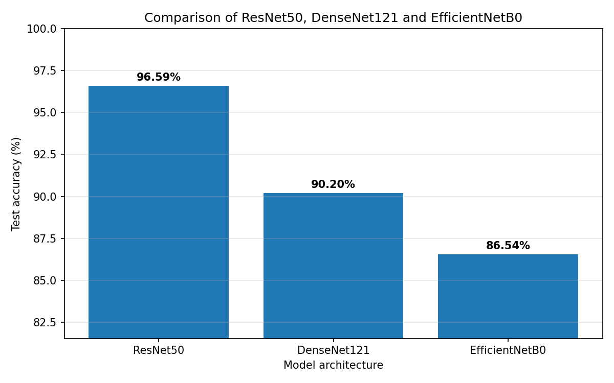
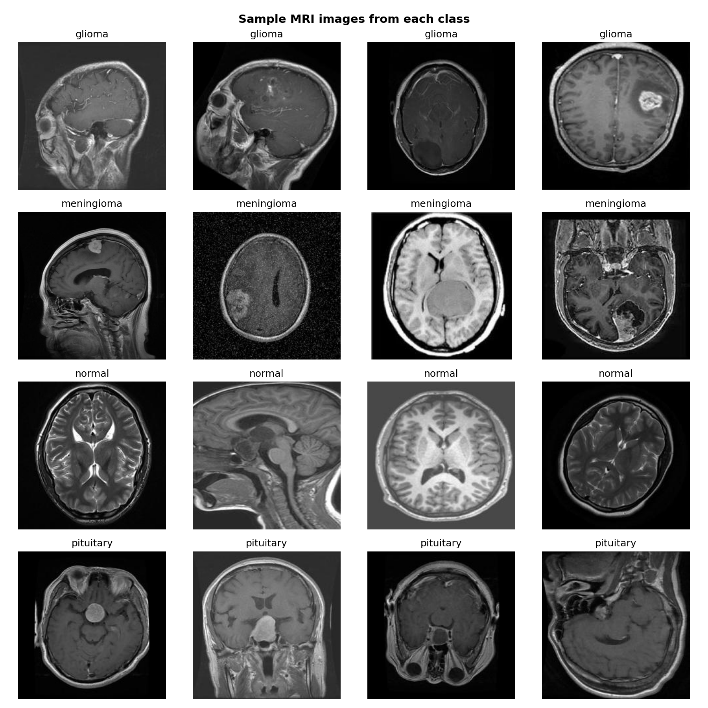
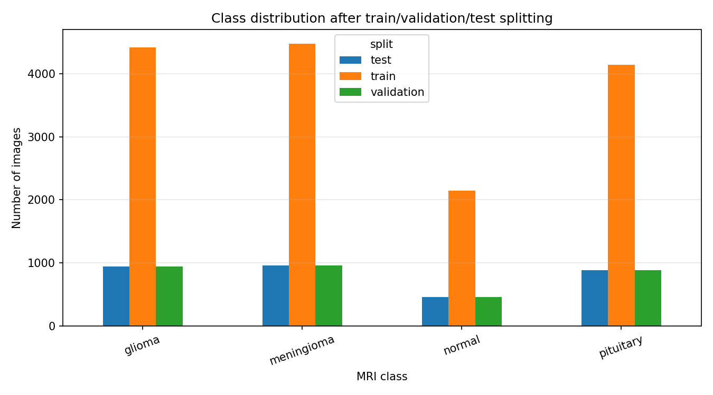
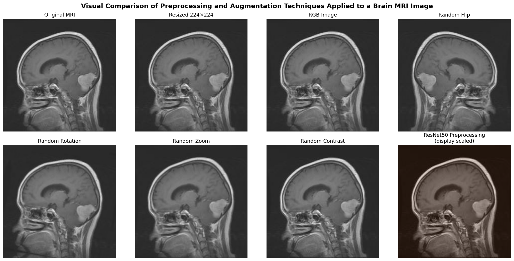
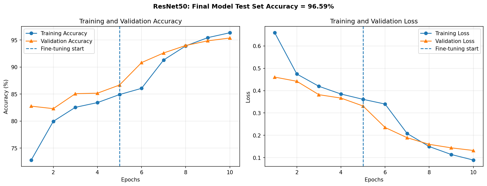
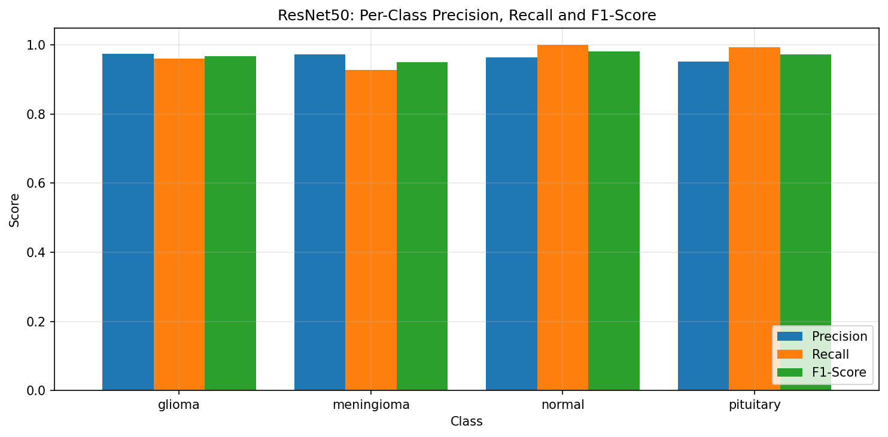
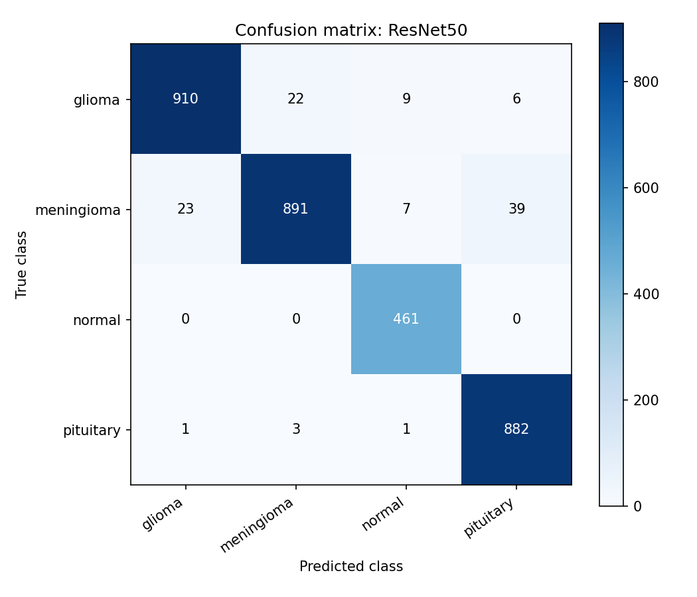
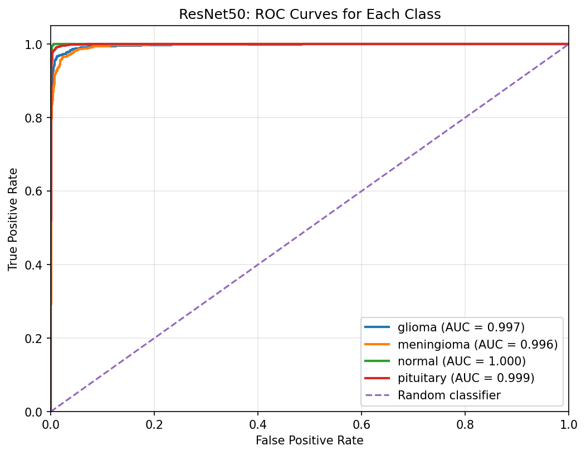
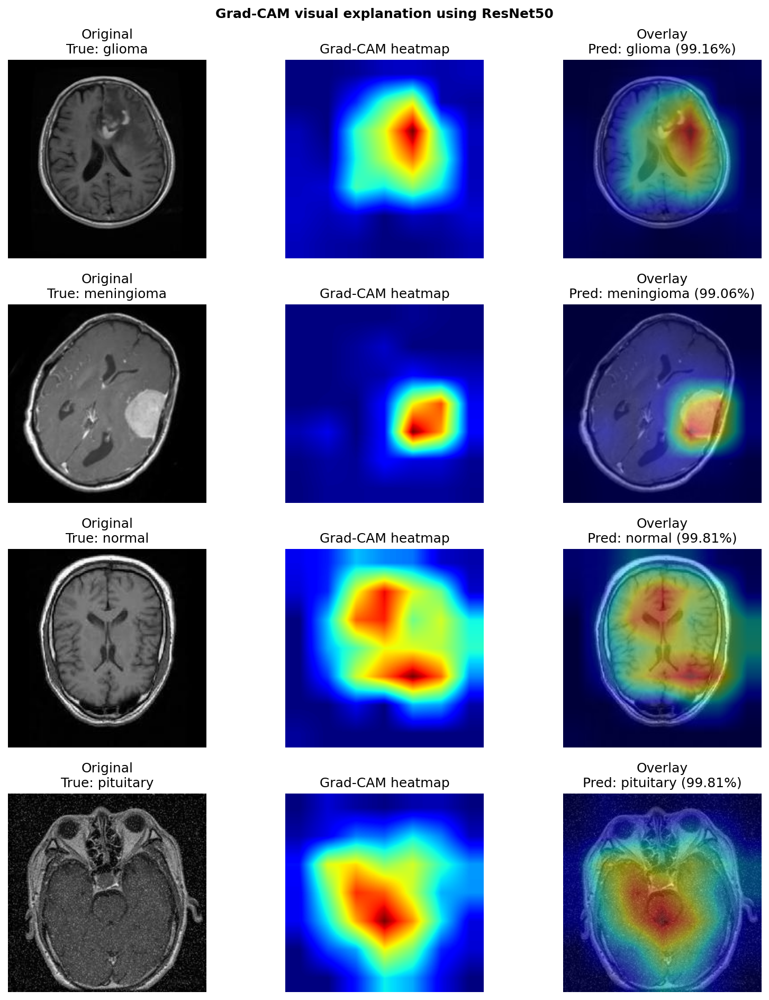

# Brain Tumor MRI Classification

Transfer-learning image-classification project comparing **ResNet50, DenseNet121 and EfficientNetB0** on a four-class brain MRI dataset.

> **Academic/educational prototype only — not for clinical diagnosis, treatment or patient-care decisions.**

## Key results

| Model | Test accuracy | Weighted F1 | Approx. training time |
|---|---:|---:|---:|
| **ResNet50** | **96.59%** | **0.9657** | 17.87 min |
| DenseNet121 | 90.20% | 0.9010 | 17.83 min |
| EfficientNetB0 | 86.54% | 0.8621 | 7.72 min |

ResNet50 produced the strongest held-out result in the completed portfolio run.



## Dataset

The project uses the public **Crystal Clean: Brain Tumors MRI Dataset** from Kaggle:

`mohammadhossein77/brain-tumors-dataset`

The working dataset contains **21,672 MRI images** across four classes:

- glioma: 6,307
- meningioma: 6,391
- normal: 3,066
- pituitary: 5,908

The repository does **not** redistribute the source MRI dataset. The notebook downloads it with `kagglehub`.



A deterministic, class-stratified **70/15/15 image-level split** produced 15,168 training images, 3,249 validation images and 3,255 held-out test images.



## Method

All three CNN backbones use the same high-level experimental setup:

- 224 × 224 RGB inputs
- ImageNet-pretrained CNN backbone
- training-only augmentation: horizontal flip, small rotation, zoom and contrast
- backbone-specific preprocessing
- global average pooling
- dense 128-unit classification layer
- dropout of 0.35 and 0.25
- four-class softmax output
- Adam optimisation
- sparse categorical cross-entropy
- class weighting for imbalance
- two-stage training: frozen-head training followed by lower-rate fine-tuning
- ModelCheckpoint, EarlyStopping and ReduceLROnPlateau callbacks



## Best model: ResNet50

ResNet50 reached **96.59% test accuracy**, test loss **0.1047**, and weighted F1 **0.9657**.



The **normal** class achieved recall of **1.0000** on 461 test images. The lowest class-level F1 was for **meningioma**, at approximately **0.9499**.



### Confusion matrix

The confusion matrix provides a class-by-class view of the held-out predictions.



Confusion matrices for DenseNet121 and EfficientNetB0 are also available in [`assets/`](assets/).

### ROC analysis

One-vs-rest ROC curves provide an additional view of class separability.



## Grad-CAM explainability

Grad-CAM was applied to selected ResNet50 test predictions to visualise image regions influencing the model.



Grad-CAM is included as an **explainability aid only**. A heatmap does not prove that the highlighted region is a clinically valid tumour boundary.

## Repository structure

```text
brain-tumor-mri-classification/
├── README.md
├── requirements.txt
├── .gitignore
├── notebooks/
│   └── brain_tumor_mri_classification.ipynb
├── assets/
│   ├── model-accuracy-comparison.png
│   ├── preprocessing-augmentation-comparison.png
│   ├── resnet50-final-training-summary.png
│   ├── confusion-resnet50.png
│   ├── confusion-densenet121.png
│   ├── confusion-efficientnetb0.png
│   ├── resnet50-per-class-metrics.png
│   ├── resnet50-roc-curves.png
│   ├── gradcam-resnet50.png
│   └── ...
└── results/
    ├── model_metrics.csv
    ├── best_model_per_class_metrics.csv
    ├── split_counts.csv
    ├── dataset_summary.csv
    ├── class_counts.csv
    └── training_options.csv
```

## Reproducing the experiment

The notebook is designed to run most easily in **Google Colab with a GPU runtime**.

Open:

```text
notebooks/brain_tumor_mri_classification.ipynb
```

and run the cells from top to bottom. The dataset is downloaded automatically through KaggleHub.

The completed portfolio run was successfully executed with **TensorFlow 2.21.0** on a Colab GPU. Neural-network training can still show small run-to-run variation because GPU execution is not guaranteed to be fully deterministic.

The figures and CSV files committed to this repository preserve the outputs from one completed end-to-end run rather than selecting the best result across repeated runs.

## Important limitations

The headline accuracy should be interpreted cautiously.

- Evaluation uses an **image-level split from one public dataset**, not external clinical validation.
- The source data were not split using verified patient identifiers. If related images from the same patient exist, patient-level leakage is therefore a potential limitation.
- The project uses 2D MRI images rather than complete 3D MRI volumes.
- Scanner, hospital and population generalisation were not tested.
- Grad-CAM does not establish clinical localisation validity.
- This model is a machine-learning demonstration, not a medical device.

Future work should prioritise patient-level splitting, duplicate/near-duplicate checks, external validation, medical-domain pretraining, and comparison with transformer or segmentation-guided approaches.

## Academic context

This project originated as an **individual CN7023 Artificial Intelligence & Machine Vision coursework project** and has been adapted into a cleaner public portfolio version. The public notebook preserves the original experimental method while removing submission-specific identifiers and report/presentation scaffolding.

## Responsible use

This repository demonstrates transfer learning, evaluation and explainability techniques for medical-image classification. It must not be used to diagnose brain tumours or make clinical decisions.
